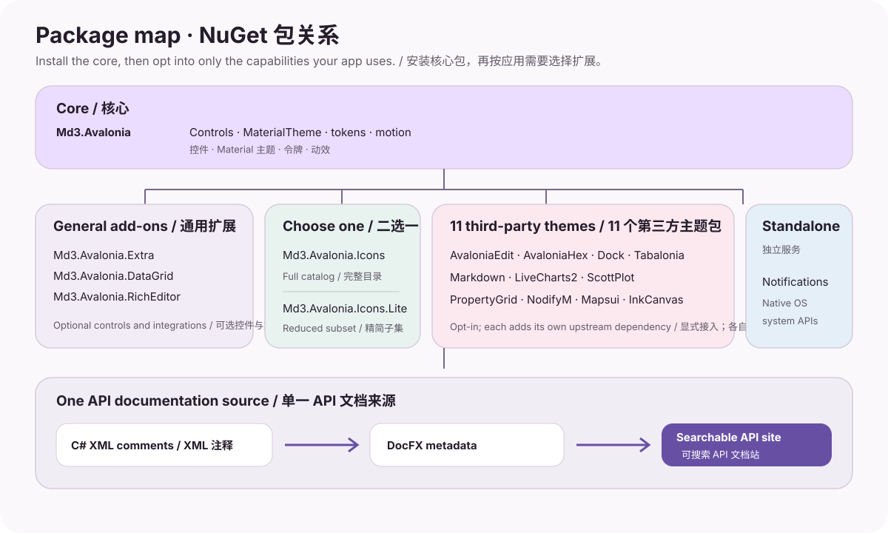

# 项目结构

[English](PROJECT_STRUCTURE.md) | [简体中文](PROJECT_STRUCTURE.zh-CN.md)

本页介绍控件库、可选包、示例、测试与生成文档所在的位置。应用通常通过 NuGet 引用；了解仓库结构有助于阅读源码或参与开发。



## 仓库目录

```text
Md3.Avalonia/
├─ src/
│  ├─ Md3.Avalonia/                  # 核心控件、令牌、动效、本地化与主题
│  ├─ Md3.Avalonia.Extra/            # 可选扩展控件、布局与模板
│  ├─ Md3.Avalonia.Icons/            # 完整 Material Symbols 字体与字形目录
│  ├─ Md3.Avalonia.Icons.Lite/       # 精简 Material Symbols 字体与目录
│  ├─ Md3.Avalonia.DataGrid/         # Avalonia DataGrid 主题
│  ├─ Md3.Avalonia.AvaloniaEdit/     # AvaloniaEdit 主题
│  ├─ Md3.Avalonia.AvaloniaHex/      # AvaloniaHex 主题
│  ├─ Md3.Avalonia.Dock/             # Dock 主题
│  ├─ Md3.Avalonia.Tabalonia/        # Tabalonia 主题
│  ├─ Md3.Avalonia.Markdown/         # Markdown.Avalonia 样式
│  ├─ Md3.Avalonia.LiveCharts2/      # LiveCharts2 主题与配置
│  ├─ Md3.Avalonia.ScottPlot/        # ScottPlot 主题
│  ├─ Md3.Avalonia.PropertyGrid/     # Avalonia.PropertyGrid 主题
│  ├─ Md3.Avalonia.NodifyM/          # NodifyM 主题
│  ├─ Md3.Avalonia.Mapsui/           # Mapsui 主题
│  ├─ Md3.Avalonia.InkCanvas/        # InkCanvas 主题与 MdSignaturePad
│  └─ Md3.Avalonia.Notifications/    # 独立的原生系统通知
├─ gallery/
│  ├─ Md3.Avalonia.Gallery/          # 桌面组件 Gallery 与示例
│  ├─ Md3.Avalonia.Gallery.Desktop/  # 桌面应用宿主
│  └─ Md3.Avalonia.Gallery.Android/  # Android single-view 宿主
├─ tests/Md3.Avalonia.HeadlessTests/ # API、行为、主题与渲染的 headless 测试
├─ docs/                             # DocFX 指南与精选参考图片
├─ templates/material/               # DocFX Modern 主题的本地 Material 3 定制
├─ .docfx/                           # DocFX 过滤器与元数据配置
├─ scripts/                          # 构建、打包、验证与覆盖率脚本
└─ spec-snapshot/                    # 固定的一致性基线与验证策略
```

## 各目录职责

| 目录 | 职责 |
|---|---|
| `src/Md3.Avalonia/Controls` | 公共控件与契约。 |
| `src/Md3.Avalonia/Themes` | `MaterialTheme`、控件样式、颜色/形状/字体令牌与动态主题代码。 |
| `src/Md3.Avalonia/Motion` | 动效方案、转场与动画辅助工具。 |
| `src/Md3.Avalonia.<Package>/` | 独立的可选包项目；第三方集成包将上游依赖隔离在核心包之外。 |
| `gallery/` | 可运行的桌面与 Android 示例；本指南中的部分代码示例取自 Gallery 页面。 |
| `tests/` | API 行为、渲染、主题与交互的 headless 回归测试。 |
| `docs/` 与 `index.md` | DocFX 中文指南、导航与预览图片。 |
| `templates/material/` | 基于 DocFX Modern 的本地 CSS 定制，不叠加第三方 Material 主题。 |
| `scripts/` and `.github/workflows/` | 可复现的包构建、静态检查、CI 与 Pages 部署。 |

## API 文档如何生成

每个可打包项目都会生成 XML 文档文件。`docfx.json` 列出 17 个包项目，DocFX 从编译后的公共 API 与 XML 注释生成可搜索的 API 参考。成员说明与 C# 声明放在一起维护；文档站另外提供任务型指南，不在 Markdown 中重复维护整份 API 清单。

DocFX Modern 的本地样式定制位于 `templates/material/public/main.css`。文档 workflow 使用与[在线预览站](https://ilwren.github.io/Md3.Avalonia/)相同的配置进行构建。

## 常用命令

```bash
# 验证包与双语 API 文档覆盖情况
python3 scripts/check-api-doc-coverage.py

# 构建桌面 Gallery
dotnet build gallery/Md3.Avalonia.Gallery.Desktop/Md3.Avalonia.Gallery.Desktop.csproj -c Release

# 运行 headless 测试
dotnet test tests/Md3.Avalonia.HeadlessTests/Md3.Avalonia.HeadlessTests.csproj -c Release
```

构建完整 solution 与发布包时可能还需安装 Android workload；详见仓库 [中文 README](https://github.com/ilwren/Md3.Avalonia/blob/arena/7fa0e0b4-md3-avalonia/README.zh-CN.md#构建与测试) 和[兼容性指南](COMPATIBILITY.zh-CN.md)。
