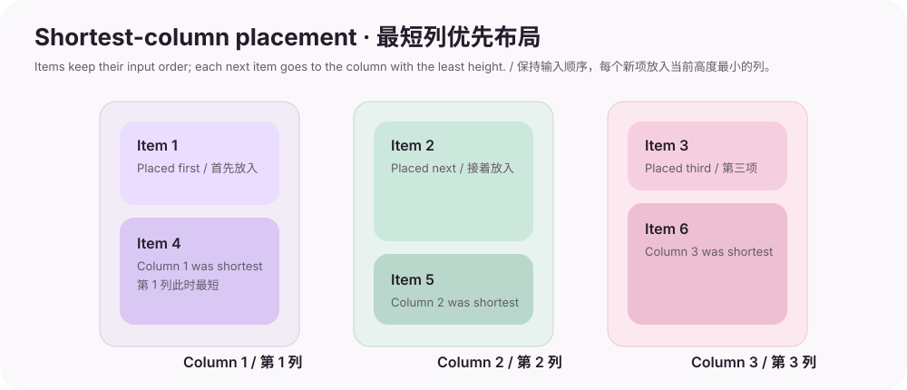

# Usage examples / 使用示例

These short examples show how the package guides fit into real screens. The screenshots are captured from the project gallery; the waterfall diagram is a purpose-made layout illustration. For a complete runnable demo, open the [Gallery source](https://github.com/ilwren/Md3.Avalonia/tree/arena/7fa0e0b4-md3-avalonia/gallery/Md3.Avalonia.Gallery/Pages).

以下示例展示如何将控件和主题包组合到真实页面中。截图来自项目 Gallery；瀑布流示意图为本指南专门绘制。完整可运行示例可查看 [Gallery 源码](https://github.com/ilwren/Md3.Avalonia/tree/arena/7fa0e0b4-md3-avalonia/gallery/Md3.Avalonia.Gallery/Pages)。

## 1. A small form / 简单表单

Use standard Avalonia bindings and commands with Md3 controls. Bind the properties to a ViewModel just as you would with native controls.

Md3 控件可直接使用 Avalonia 标准绑定与命令。和原生控件一样，将属性绑定到 ViewModel 即可。

```xml
<StackPanel Margin="24" Spacing="16">
  <TextBlock Text="New workspace" />
  <md:MdTextBox Label="Workspace name"
                Text="{Binding WorkspaceName}" />
  <md:MdComboBox Label="Platform"
                 Variant="Outlined"
                 ItemsSource="{Binding Platforms}"
                 SelectedItem="{Binding SelectedPlatform}" />
  <md:MdButton Content="Create workspace"
               Variant="Filled"
               Command="{Binding CreateCommand}" />
</StackPanel>
```

`md` is the `Md3.Avalonia.Controls` namespace. Register `MaterialTheme` in `App.axaml` first; see the [quick start](GETTING_STARTED.md).

上例中的 `md` 对应 `Md3.Avalonia.Controls` namespace。先在 `App.axaml` 中注册 `MaterialTheme`；详见[快速上手](GETTING_STARTED.md)。


## 2. Icon actions / 图标操作按钮

Install either `Md3.Avalonia.Icons` or `Md3.Avalonia.Icons.Lite`, then use the public glyph catalog with the core icon button. The font is embedded and registered by the icon package.

安装 `Md3.Avalonia.Icons` 或 `Md3.Avalonia.Icons.Lite` 之一，再通过公开图标目录为核心图标按钮指定 glyph。图标包会自动注册内嵌字体。

```xml
<StackPanel Orientation="Horizontal" Spacing="12">
  <md:MdIconButton Icon="{x:Static md:MdSymbols.Edit}"
                   Variant="Filled"
                   Command="{Binding EditCommand}"
                   AutomationProperties.Name="Edit workspace" />
  <md:MdButton Content="Create"
               Variant="Tonal"
               Command="{Binding CreateCommand}" />
</StackPanel>
```

`MdSymbols` lives in the same `Md3.Avalonia.Controls` XAML namespace as `MdIconButton`. Use `MdSymbolsLite` when you installed the Lite package.

`MdSymbols` 与 `MdIconButton` 位于相同的 `Md3.Avalonia.Controls` XAML namespace。若安装 Lite 包，则使用 `MdSymbolsLite`。


## 3. Apply a dynamic color scheme / 应用动态配色

Generate roles from a seed color and apply them at application scope. Call this after registering `MaterialTheme`; theme resources are dynamic, so controls update when the roles change.

从 seed color 生成色彩角色，并在应用级别应用。请在注册 `MaterialTheme` 后调用；主题资源为动态资源，角色变化时控件会随之更新。

```csharp
using Avalonia.Controls;
using Avalonia.Styling;
using Md3.Avalonia.Themes.Dynamic;

var application = Application.Current!;
var options = new MdThemeOptions
{
    SeedColor = "#006A6A",
    SchemeVariant = MdThemeSchemeVariant.Expressive,
    ContrastLevel = MdThemeContrastLevel.High,
    ThemeMode = MdThemeMode.System
};

var useDarkScheme = application.ActualThemeVariant == ThemeVariant.Dark;
MdThemeManager.Apply(application, options, useDarkScheme);
```

`ThemeMode.System` also tracks later system light/dark changes. The [API reference](https://ilwren.github.io/Md3.Avalonia/) documents the scheme, contrast, motion, and shape options.

`ThemeMode.System` 也会跟踪系统后续的浅色/深色变化。各 scheme、对比度、动效与形状选项详见 [API 参考](https://ilwren.github.io/Md3.Avalonia/)。

## 4. Staggered cards with Extra / 使用 Extra 排列错落卡片

After adding `Md3.Avalonia.Extra` and registering `ExtraTheme` after the core theme, `MdWaterfall` distributes children into the shortest column. Set `Columns` to pin the number of columns; leave it at zero to derive a responsive count from `MinColumnWidth`.

添加 `Md3.Avalonia.Extra`，并在核心主题后注册 `ExtraTheme`。`MdWaterfall` 会把子项放入当前最短的列。设置 `Columns` 可固定列数；保持默认值 0 时，则根据 `MinColumnWidth` 自适应计算列数。

```xml
<eco:MdWaterfall MinColumnWidth="220"
                 ColumnSpacing="12"
                 ItemSpacing="12">
  <md:MdCard Variant="Elevated" Height="120" />
  <md:MdCard Variant="Filled" Height="190" />
  <md:MdCard Variant="Outlined" Height="90" />
  <md:MdCard Variant="Elevated" Height="160" />
  <md:MdCard Variant="Filled" Height="110" />
  <md:MdCard Variant="Outlined" Height="200" />
</eco:MdWaterfall>
```

Use `xmlns:eco="using:Md3.Avalonia.Extra.Controls"` and `xmlns:md="using:Md3.Avalonia.Controls"`. `MdWaterfall` also supports `ItemsSource` for data-bound collections. See [NuGet packages / NuGet 包](NUGET_PACKAGES.md) for the optional package details.

使用 `xmlns:eco="using:Md3.Avalonia.Extra.Controls"` 和 `xmlns:md="using:Md3.Avalonia.Controls"`。`MdWaterfall` 也支持 `ItemsSource` 绑定集合。可选包详情请见 [NuGet 包指南](NUGET_PACKAGES.md)。



## 5. ViewModel-driven dialogs / 由 ViewModel 驱动的对话框

Keep ViewModels free of control references: inject `IMdDialogService`, show a dialog model, and await its result. The full guide includes the host, data templates, cancellation, and popup ownership behavior.

让 ViewModel 不持有控件引用：注入 `IMdDialogService`，显示对话框模型并等待结果。完整指南涵盖 Host、DataTemplate、取消行为与弹层所有权协调。

See the [dialog service guide](DIALOG_SERVICE.md) and its matching API reference for a complete example.

完整示例请参阅[对话框服务指南](DIALOG_SERVICE.md)及对应 API 参考。
